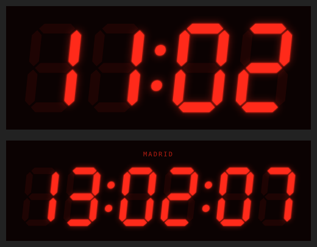

# SlopClock card for Home Assistant

A Lovelace card that shows the current time in 24 hour (or 12 hour) format, drawn as a red seven segment LED display. Unlit segments glow faintly, lit ones bloom, and the colon blinks every second.



## Install

### HACS (custom repository)
1. HACS > three dots > **Custom repositories**
2. Add `https://github.com/dongasaurus/SlopClock`, type **Dashboard**
3. Install **SlopClock**, then reload your browser

### Manual
1. Copy `ha80s-digital-clock.js` to `<config>/www/`
2. Settings > Dashboards > three dots > **Resources** > Add resource
   - URL: `/local/ha80s-digital-clock.js`
   - Type: **JavaScript module**
3. Reload your browser

## Use

Add a card to your dashboard, pick **Manual**, and paste:

```yaml
type: custom:ha80s-digital-clock
```

## Options

| Option          | Default    | Description |
|-----------------|------------|-------------|
| `show_seconds`  | `false`    | Show `HH:MM:SS` instead of `HH:MM` |
| `hour_format`   | `24`       | `24` for `13:05`, or `12` for ` 1:05` with an AM/PM indicator |
| `blink_colon`   | `true`     | Blink the colon once per second |
| `color`         | `#ff2a1a`  | LED colour (any CSS colour) |
| `background`    | `#0b0202`  | Card background |
| `ghost_opacity` | `0.08`     | Brightness of unlit segments (`0` hides them) |
| `glow`          | `true`     | Glow around lit segments |
| `time_zone`     | `local`    | `local` (browser), `server` (Home Assistant's zone) or an IANA name like `Europe/Madrid` |
| `title`         | none       | Optional label above the clock |

### Example

```yaml
type: custom:ha80s-digital-clock
show_seconds: true
time_zone: server
title: Kitchen
```
